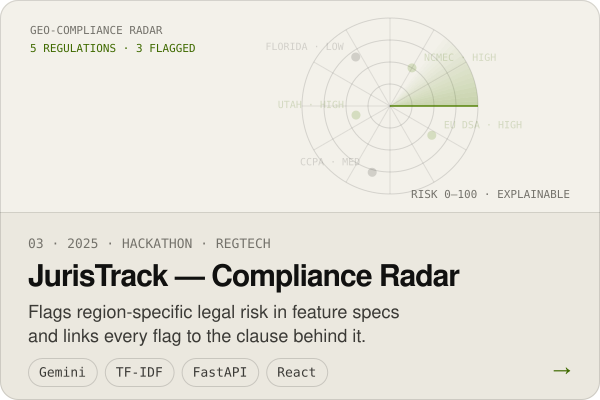
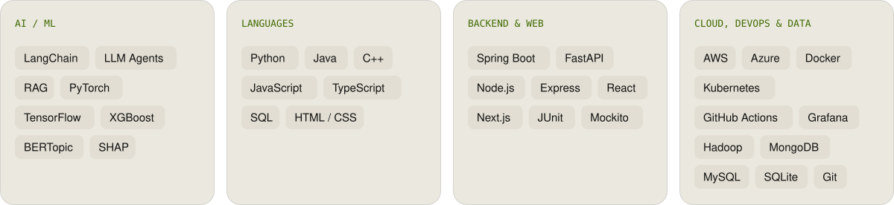

<a href="https://rayaanq.github.io/Portfolio/">
  <picture>
    <source media="(prefers-color-scheme: dark)" srcset="assets/header-dark.svg">
    
  </picture>
</a>

  
  
  

### ✦ Hey, I'm Rayaan

I'm a software and AI engineer in Singapore. By day I build production microservices for medical software. The rest of the time I build RAG pipelines, LLM agents and ML forecasters, and I keep asking whether the system actually helps someone decide something.

- 🔭 **Now:** Software Developer Intern at **BIOTRONIK**. I help migrate a monolith to Spring Boot microservices, run CI/CD on Docker · Kubernetes · Azure, build Grafana dashboards, and roll out Claude Code across global teams.
- 🎓 **Studying:** Master of Computing in AI at **NUS** (GPA 4.67 / 5). Before that, B.E. Computer Engineering at the University of Mumbai (GPA 9.97 / 10).
- 🏅 **Credentials:** AWS Certified Developer – Associate · Springer Nature publication · 3× institute-level competition winner
- 💬 **Looking for:** Software Development and AI Engineering roles. [Let's talk.](mailto:rayyaanquraishi@gmail.com)

### ✦ Selected work

  <a href="https://github.com/RayaanQ/community-crisis-predictor"><picture><source media="(prefers-color-scheme: dark)" srcset="assets/card-crisis-dark.svg"></picture></a>
  <a href="https://github.com/RayaanQ/AI-Web-Page-Summarizer"><picture><source media="(prefers-color-scheme: dark)" srcset="assets/card-summarizer-dark.svg"></picture></a>

  <a href="https://github.com/RayaanQ/JurisTrack"><picture><source media="(prefers-color-scheme: dark)" srcset="assets/card-juristrack-dark.svg"></picture></a>
  <a href="https://github.com/RayaanQ/Misarticulation-Project"><picture><source media="(prefers-color-scheme: dark)" srcset="assets/card-lingoleap-dark.svg"></picture></a>

Full case studies on my <a href="https://rayaanq.github.io/Portfolio/#work">portfolio</a>. While you're there, press <kbd>`</kbd> for a terminal.

<b>More things I've built</b>

 

| Project | What it is | Built with |
|---|---|---|
| Greenory | Estimates the carbon footprint of code and suggests lower-carbon rewrites ([case study](https://rayaanq.github.io/Portfolio/#case-greenory)) | AST analysis · LLMs · GitHub API |
| [Movie Recommender](https://github.com/RayaanQ/Movie-Recommendation-System) | Content-based recommendations over the TMDB 5000 dataset | scikit-learn · Streamlit |
| [SMS Spam Classifier](https://github.com/RayaanQ/SMS-Spam-Classifier) | NLP pipeline that separates spam from ham | NLP · Streamlit |
| [Fitness Tracker](https://github.com/RayaanQ/Fitness-Tracker-API) | Exercise logging app | MongoDB · Express · React · Node |
| [Hospital Management System](https://github.com/RayaanQ/Hospital-Management-System) | Appointment booking for a clinic | Node.js · MongoDB |
| [Data Structures](https://github.com/RayaanQ/Data-Structures) | Linked lists in C++, explained from beginner to advanced | C++ |
| [Portfolio](https://github.com/RayaanQ/Portfolio) | My hand-coded, framework-free portfolio site | HTML · CSS · JS |

### ✦ Toolbox

<picture>
  <source media="(prefers-color-scheme: dark)" srcset="assets/toolbox-dark.svg">
  
</picture>

### ✦ Activity

<picture>
  <source media="(prefers-color-scheme: dark)" srcset="assets/stats-dark.svg">
  
</picture>

<picture>
  <source media="(prefers-color-scheme: dark)" srcset="assets/snake-dark.svg">
  
</picture>

Every graphic here is generated by this repo: <code>scripts/build.py</code> draws the animated SVGs, and a daily GitHub Action refreshes the stats and the snake.

